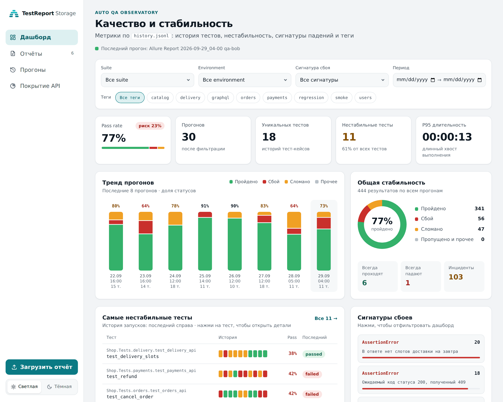
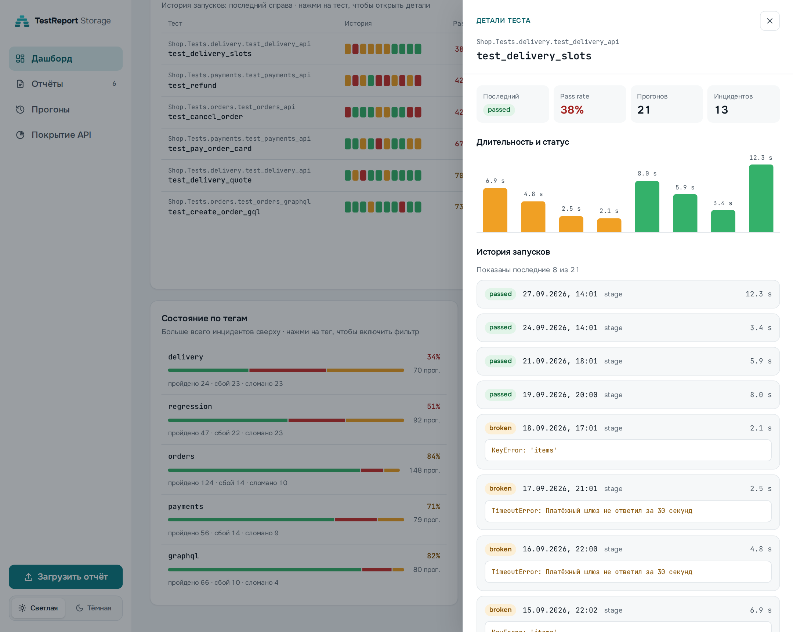
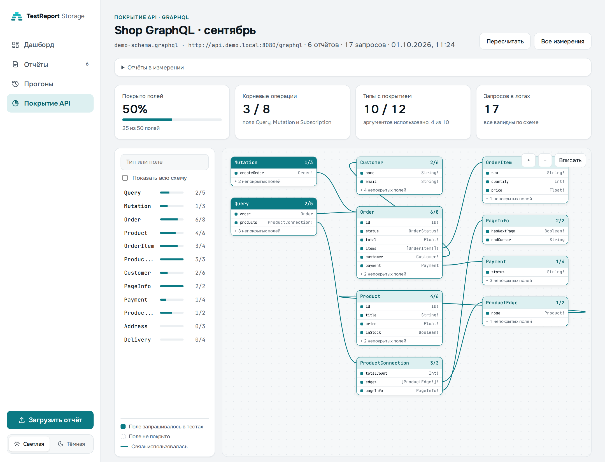

# TestReport Storage

Web application for storing and viewing Allure test reports, with quality analytics over run history
and API coverage measurement (REST via OpenAPI, GraphQL via schema) built from test logs.



| Test details | API coverage: GraphQL |
|---|---|
|  |  |

More screenshots and a product overview (in Russian): [README.md](./README.md).

This is an independent product for storing, browsing, and analyzing test reports generated by Allure Report, including reports produced in the [allure-framework/allure3](https://github.com/allure-framework/allure3) ecosystem.

## Project Structure
- `frontend` - Vue 3 application (UI for report management and viewer)
- `backend` - FastAPI service (upload/download/list/delete reports, history management)
- `storage` - runtime directory for report files and `history.jsonl`, ignored by git


## Backend Structure
The internal backend code for reports and history now lives in the `app/services/reporting` package.

The logic is split by responsibility:
- `app/services/reporting/reports.py` - report service
- `app/services/reporting/history.py` - `history.jsonl` service
- `app/services/reporting/history_index.py` - build/update logic for `history_index.json`
- `app/services/reporting/analytics.py` - dashboard aggregates
- `app/services/reporting/runs.py` - runs restored from the history index
- `app/services/jira/` - Jira bugs: steps and stand from the report, description markup, Jira client, issue-to-failure links
- `app/services/coverage/` - API coverage: log parsing, OpenAPI and GraphQL schema matching
- `app/services/reporting/repositories/` - file-based repositories
- `app/services/reporting/models.py` - internal typed models

This is intentional so the code package is not confused with the runtime `storage/` directory.

## API Documentation (Swagger/OpenAPI)
When backend is running:
- Swagger UI: `http://localhost:8000/docs`
- ReDoc: `http://localhost:8000/redoc`
- OpenAPI JSON: `http://localhost:8000/openapi.json`

In Docker deployment (through frontend proxy):
- Swagger UI: `http://localhost:9999/docs`
- ReDoc: `http://localhost:9999/redoc`
- OpenAPI JSON: `http://localhost:9999/openapi.json`

## Run with Docker
Container images are built by the company CI/CD pipeline; the Dockerfiles are not stored in this repository.
Both builds use the repository root as the build context:
- Backend: `COPY ./backend/ ./` — uvicorn on port 8000, storage at `/app/storage` (`APP_STORAGE_ROOT`)
- Frontend: multi-stage `node:22` → `nginx` — UI on port 80; `/api` and `/reports-static` are proxied to the backend (set the `VITE_API_BASE` build arg if the UI and backend run on different hosts)

Deployed endpoints:
- App UI: `http://localhost:9999`
- Backend (internal docker network): `allure-storage-backend:8000`

## Local Development Run
### Backend
```bash
cd backend
python3 -m venv .venv
source .venv/bin/activate
pip install -r requirements.txt
uvicorn app.main:app --host 0.0.0.0 --port 8000 --reload
```

### Frontend
```bash
cd frontend
npm ci
npm run dev
```

Frontend dev server: `http://localhost:5173`

## Main Features
- Quality dashboard over run history: pass rate and risk, run trend, unstable tests with a strip of recent statuses, failure signatures, tag health
- Dashboard filters by suite, environment, failure signature, period and tags (with tag search); filters are kept in URL query parameters
- Test details drawer: last status, pass rate, duration per run, run history with error messages
- Allure report upload (`.zip`), list with search and status filter, embedded viewer, download and delete
- "Test results" tab for a report: failed and all tests read from the report's own Allure data
- "Runs" section: runs restored from `history.jsonl`, paged from the server, with per-run test results
- API coverage: REST via OpenAPI/Swagger and GraphQL via schema (SDL or introspection) from test log attachments; GraphQL Voyager-style schema graph
- Jira bugs from failed report tests: steps, requests, stand, author, logs; issue-to-failure links and duplicate detection (see [Jira integration](#jira-integration))
- `history.jsonl` upload/download with incremental index updates
- Light and dark themes
- Automatic report retention by limit (default: keep last 10 reports)
- Healthcheck endpoint: `GET /health`

## Reports API
- `GET /api/reports` - get the list of uploaded Allure reports with metadata
- `POST /api/reports/upload` - upload a new Allure report as a `ZIP` archive (`multipart/form-data`, `file` field)
- `GET /api/reports/{report_id}/download` - download a specific report as a `ZIP` archive
- `GET /api/reports/{report_id}/results?status=incidents|changes|all|failed|broken|passed` - test results from the report's Allure data (failed and broken by default). Each result is compared with the previous run of the test in history (`change`: `new_failure` / `still_failing` / `fixed` / `new_test`, `previous`), counters are in `changes`; `status=changes` keeps new failures and fixed tests
- `DELETE /api/reports/{report_id}` - delete a report by its identifier

## History API
- `GET /api/history` - download the current `history.jsonl`
- `POST /api/history` - upload a new `history.jsonl`
- `GET /api/history/info` - get `history.jsonl` metadata
- `GET /api/history/dashboard` - get dashboard aggregates without downloading the whole file
- `GET /api/history/dashboard/tests/{test_key}` - get selected test details for the dashboard
- `POST /api/history/rebuild-index` - force a full reread of `history.jsonl` and rebuild `history_index.json`
- `GET /api/history/runs?search=&status=&limit=&offset=` - paged list of runs from the history index
- `GET /api/history/runs/{run_uuid}/results?status=incidents|changes|all|...` - test results of a run, compared with the previous run

## Coverage API
- `GET /api/coverage` - list coverage measurements
- `POST /api/coverage` - create a measurement (`multipart/form-data`): `kind` (`rest` | `graphql`), `spec` (`openapi.json` or a GraphQL schema — SDL or introspection JSON), `report_ids` (comma-separated), `name`, for REST `base_path` and optional `host` filter (comma-separated), for GraphQL `endpoint`
- `GET /api/coverage/{id}` - measurement result
- `POST /api/coverage/{id}/recalculate` - recalculate with the stored spec and the same reports
- `DELETE /api/coverage/{id}` - delete a measurement

How coverage is calculated:
- Source: plain-text log attachments of tests in uploaded reports (`data/attachments/*.txt`), `api_controller` records: `Запрос: METHOD URL`, `Статус код ответа: NNN`, `Запрос: "URL" <graphql query> Переменные: ...`
- REST: calls are matched to path templates with the base path applied. The host from `servers` is not used as a filter (generators often write the host the spec was downloaded from). Without an explicit host, the service's hosts are those with at least one matched call; other hosts are listed separately
- GraphQL: queries are validated and walked over the schema with `graphql-core`; fields, arguments, fragments and unions are counted
- A measurement is a snapshot stored in `storage/coverage/<id>/` (spec, parameters, result)

## Jira integration
Bugs are filed in Jira Server / Data Center 9.x from failed tests of an uploaded report.
The backend makes every Jira request as one service account with its Personal Access Token:
TestReport Storage users need no Jira access, and the token never reaches the browser.

### Features
- **Where to file a bug**: the "Создать баг" button in the report header (the test is picked in the dialog) or the bug icon on a failed test row in the "Results" tab (the test is preselected). The icon is highlighted for new failures
- **Steps to reproduce** come from Allure in order, split into setup, test and teardown. The default selection is the path to the failure: top-level steps except skipped ones plus the chain of steps down to the failed one; setup and teardown are off unless the test broke there. Presets "path to failure", "all", "none", and any step by its checkbox
- **Repeats don't flood the issue**: consecutive steps with the same name (retries, status polling) fold into a group of attempts; the last one goes into the issue by default. When the wait step itself failed (a timeout), its last poll is taken — it shows what the service answered. The same step repeated elsewhere in the scenario stays a separate step
- **Requests**: each step shows its request (`POST /api/v1/orders → 201`); the description gets the requests of the chosen steps plus the request and response bodies the test broke on. Log modes: step requests, full log (its beginning is cut when it exceeds Jira's 32 000 characters), no log
- **Attachments**: test logs and screenshots are attached by default, the failing request dump on demand; size limit is `JIRA_MAX_ATTACHMENT_MB`
- **Stand** — the most called host of the test without the port: services of one stand differ by port only (`host:4001`, `host:18081` → `http://host`). Stand names can be set in `JIRA_STAND_NAMES`
- **Test author** — `User` from the report's `widgets/variables.json`; suggested as the assignee when Jira has such a user
- **Issue fields**: summary (`[Автотест] Test: Error type — message`, editable), priority and components from the project, labels (`JIRA_DEFAULT_LABELS` + test tags), Environment (stand and run). The expected result is required — a person writes it
- **Preview** of the description and a "Jira markup" tab with the exact text that is sent
- **Masking**: auth headers, Bearer tokens, JWTs and values of `password`, `token`, `secret`, `api_key` and similar keys are removed from logs and dumps before upload (extra keys: `JIRA_MASK_KEYS`)
- **Duplicates**: an issue is linked to a failure by test and error signature (`storage/jira/links.json`). A chip with the key and the Jira status shows on the test row — also in later reports where the test fails the same way. The dialog warns when an issue for this failure exists, or when another test with the same error already has one; the repeated failure can be added to it as a comment

### What the tests need to provide
The integration reads Allure 3 reports and needs no test changes if the tests already write:
- **Allure steps** (`allure.step`) — they become the steps to reproduce
- **A JSON attachment per step with the request and response** — the step request, the stand and the failing request body come from it:
  ```json
  {
    "request_line": "POST http://stand.company.com:4001/api/v1/orders",
    "request_body": {"sku": "SKU-1"},
    "response_status_code": 201,
    "response_body": {"id": 1}
  }
  ```
  Without such attachments the steps still go into the issue and the stand is detected from URLs in the text log
- **The `User` variable** in `widgets/variables.json` (set via `variables` in the Allure 3 report config) — the test author
- **A text log** of the test (`.txt` / `.log`) — for the attachment and the full log mode

### Setup
1. **Service account.** Create a Jira user for autotests (e.g. `svc-autotest`) and grant it in the target project:
   - *Browse Projects*, *Create Issues*, *Create Attachments*, *Add Comments* — required
   - *Assign Issues* — to set the assignee; assignees need *Assignable User*
   - global *Browse users and groups* — to check that the test author exists in Jira (without it the assignee is filled in unchecked)
2. **Personal Access Token.** Log in as the service account → profile → *Personal Access Tokens* → *Create token*. Pick a generous expiry and note the date: once it expires Jira answers 401
3. **Issue type.** Make sure the project has the `Bug` type (or set yours in `JIRA_ISSUE_TYPE`) and that its create screen has no required fields besides summary, priority, components, labels, assignee and Environment — the form cannot fill others
4. **Environment variables.** For `docker compose`, put them into `.env` next to `docker-compose.yml` (the file is git-ignored):
   ```bash
   JIRA_BASE_URL=https://jira.company.com
   JIRA_TOKEN=<personal access token>
   JIRA_PROJECT_KEY=CLM
   APP_PUBLIC_URL=https://test-reports.company.com
   # optional
   JIRA_STAND_NAMES=stand.company.com=stage
   JIRA_DEFAULT_LABELS=autotest
   ```
   `APP_PUBLIC_URL` is the TestReport Storage address used for links from the issue to the report and the Allure test. All variables are listed in [Configuration](#configuration)
5. **Jira certificate.** If Jira uses an internal CA, mount it into the container and point `JIRA_CA_BUNDLE` at it:
   ```yaml
   # docker-compose.override.yml
   services:
     backend:
       volumes:
         - ./certs/company-ca.pem:/app/certs/company-ca.pem:ro
   ```
   with `JIRA_CA_BUNDLE=/app/certs/company-ca.pem` in `.env`. `JIRA_VERIFY_SSL=false` disables verification entirely — test stands only
6. **Restart and check.** `docker compose up -d`, then:
   ```bash
   curl http://localhost:8080/api/jira/config   # "enabled": true
   curl http://localhost:8080/api/jira/meta     # issue type, priorities, components
   ```
   `meta.unsupportedRequired` lists required project fields the form lacks — if it is not empty, Jira will reject issues (see step 3)
7. **First bug.** Open a report with failures → "Results" → the bug icon on a test → fill in the expected result → create. The issue chip then shows on the test row

Without Jira configured the buttons stay: the draft and the preview work, and filing tells which variables are missing.

### Troubleshooting
- **"Jira отклонила токен"** — the token is wrong, revoked or expired: issue a new one (step 2)
- **"Сервисному аккаунту не хватает прав"** — check the project permissions (step 1)
- **"Jira: <field>: …"** on create — the project requires a field the form lacks, or a value does not fit the create screen: see `unsupportedRequired` in `/api/jira/meta`
- **"В проекте нет типа задачи …"** — set `JIRA_ISSUE_TYPE` to the issue type name used in the project
- **"Jira недоступна: ConnectError / ConnectTimeout"** — the backend cannot reach `JIRA_BASE_URL`: check the container network, proxy and `JIRA_TIMEOUT_SECONDS`
- **Certificate error** — set `JIRA_CA_BUNDLE` (step 5)
- **No assignee suggested** — the `User` login from the report does not exist in Jira, or the account lacks *Browse users and groups*; type the assignee manually
- **Wrong stand** — the test calls a third-party service more often than the stand: the stand is the majority host, check `request_line` in the step attachments
- **No status on the issue chip** — the issue was deleted or moved, or Jira is temporarily unavailable; the key stays and the status is fetched again next time the report is opened

## Jira API
- `GET /api/jira/config` - whether the integration is on, Jira URL, project
- `GET /api/jira/meta` - issue type, priorities and components of the project (from createmeta, cached for 10 minutes)
- `GET /api/jira/draft?report_id=&test_id=` - bug draft for a test: steps by section, stand, author, attachments, suggested summary and labels, issues already filed
- `POST /api/jira/preview` - issue description in Jira wiki markup for the chosen steps and log mode
- `POST /api/jira/issues` - file a bug: issue, attachments, link to the failure
- `POST /api/jira/issues/{key}/comments` - add a repeated failure as a comment to an existing issue
- `GET /api/jira/links?report_id=` - issues filed for the tests of a report, with statuses from Jira

Setup and behaviour are described in [Jira integration](#jira-integration).

## UI
Pages (`http://localhost:9999` in Docker deployment or `http://localhost:5173` in frontend dev mode):
- `/dashboard` - quality dashboard
- `/reports`, `/reports/{id}` - uploaded reports
- `/runs`, `/runs/{uuid}` - runs from history
- `/coverage`, `/coverage/new`, `/coverage/{id}` - API coverage measurements

What the Dashboard shows:
- KPIs: pass rate with risk, runs, unique tests, unstable tests, P95 duration
- Recent runs trend for `passed / failed / broken`; a click opens the report or the run
- Overall stability: status distribution and always passed / always failed / incidents lists
- Most unstable tests (with both passing and failing runs) and a strip of their last 10 statuses
- Top failure signatures and tag health; a click applies the corresponding filter
- Problem runs among uploaded reports

How the data is used:
- Report summary and test results come from extracted Allure reports
- QA metrics, trends and runs are built from the aggregated index `storage/history_index.json`
- `history_index.json` is created lazily on the first `history.jsonl` processing and is not required at service startup
- When a new `history.jsonl` only appends data at the end, the backend usually reads only the new tail and updates the index incrementally
- If the index is missing, corrupted, or suspected to be out of sync, call `POST /api/history/rebuild-index` to force a full rebuild
- If `history.jsonl` is missing, history-based widgets remain empty-state

## Configuration
Backend environment variables:
- `APP_STORAGE_ROOT` - storage directory path (default: `storage`)
- `APP_MAX_REPORTS` - maximum number of stored reports (default: `10`)
- `APP_MAX_UPLOAD_SIZE_MB` - maximum uploaded ZIP size (default: `512`)
- `APP_HISTORY_MAX_FILE_SIZE_MB` - maximum `history.jsonl` size (default: `100`)
- `APP_MAX_INDEXED_RUNS` - how many latest runs the history index keeps (default: `1000`)
- `APP_CORS_ORIGINS` - comma-separated allowed origins when UI and backend run on different hosts

Jira integration (Server / Data Center 9.x, issues are filed by a service account):
- `JIRA_BASE_URL` - Jira URL, e.g. `https://jira.company.com`
- `JIRA_TOKEN` - Personal Access Token of the service account
- `JIRA_PROJECT_KEY` - project bugs are filed in
- `JIRA_ISSUE_TYPE` - issue type (default: `Bug`)
- `JIRA_DEFAULT_LABELS` - comma-separated labels of every issue (default: `autotest`)
- `JIRA_VERIFY_SSL` - `false` to skip Jira certificate verification; `JIRA_CA_BUNDLE` - path to a custom CA
- `JIRA_MAX_ATTACHMENT_MB` - maximum attachment size (default: `10`)
- `JIRA_STAND_NAMES` - stand names by host: `host=stage,host2=dev`
- `JIRA_MASK_KEYS` - extra comma-separated keys whose values are masked
- `JIRA_TIMEOUT_SECONDS` - Jira request timeout (default: `20`)
- `APP_PUBLIC_URL` - TestReport Storage URL for links from the issue to the report and the Allure test

Retention behavior:
- After uploading a new report, if the total count exceeds `APP_MAX_REPORTS`,
  the oldest report directories are removed automatically.